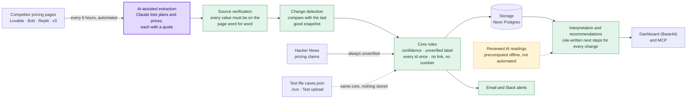
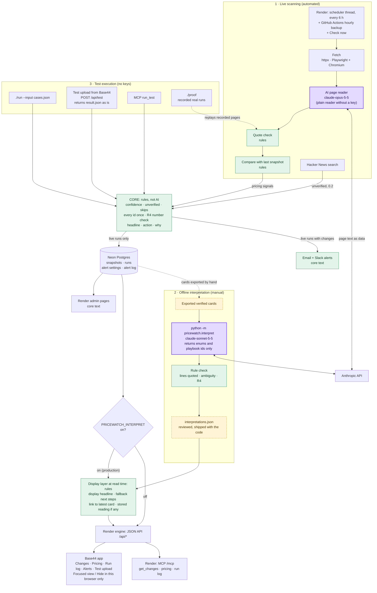

# Pricing Watch: competitor pricing for Brightloop's Head of Growth

Home assignment for the AI Marketing Builder role at Base44.

**What it does for Maya.** Maya owns signups and trial starts at Brightloop. Last quarter a wrong AI summary ("a competitor cut prices 30%") reached leadership, so her rule is *no link, no number*. Pricing Watch checks the pricing pages of Lovable, Bolt, Replit and v0 every 6 hours, finds what changed since the last check, and shows each change with the exact quote, its link, how far to trust it, and what to check or do next. Claims from anywhere else (Hacker News, ads, blogs) are shown but labelled unverified. See `docs/spec.md`.

| | |
| --- | --- |
| Live app (for marketers) | https://brightloop-competitors-price-pulse.base44.app (Base44; source mirrored in `frontend/`) |
| Engine, API and admin pages | https://pricewatch-mb2k.onrender.com (Render + Neon) |
| Proof, no keys | `./proof` on a fresh clone (Python 3.12+, standard library only) |
| The brief's test interface | `./run --input cases.json --output result.json`, or **Test upload** in the live app |
| Ask Claude (MCP) | `https://pricewatch-mb2k.onrender.com/mcp` as a custom connector |
| How it's built | `docs/architecture.md` (authoritative) |
| Decision log | `DECISIONS.md` (D1–D44) |
| Plain-English walkthrough | `docs/INTERVIEW-ARCHITECTURE-EXPLAINED.md` |

## Quick start (no keys)

```
git clone https://github.com/bermanguy/brightloop-ai-marketing-builder && cd brightloop-ai-marketing-builder
./proof                                                              # ends with PROOF PASSED, exit 0
./run --input fixtures/sample-cases.json --output result.json        # the brief's sample: 2 items, 6 skipped
./run --input tests/cases/2-injections-and-secrets.json --output result.json
```

Tests (needs pip): `python3 -m venv .venv && . .venv/bin/activate && pip install -e ".[dev,web]" && pytest`.

## Current verified results

Run on 3 November 2026 in a fresh clone of this branch, in a new virtual environment, with an empty environment (no API keys, no `DATABASE_URL`):

| Check | Result |
| --- | --- |
| `./proof` | PROOF PASSED, exit 0: the brief's 8 sample ids and 3 recorded real runs. With one recorded price altered, it fails with exit 1 |
| `pytest` | 295 passed, 4 skipped, 0 failed |
| `./run` on the sample and the 4 case files | Counts match `tests/cases/README.md`; two runs give identical output apart from `run.started_at` |
| CLI vs Test upload API vs MCP `run_test` | Identical `result.json` for every case file, interpretation flag on or off |
| Frontend `npm run lint` / `npm run build` | Clean / builds (one chunk-size warning) |
| Production MCP `run_test` on `3-malformed-input.json` | Same `result.json` as the CLI. Its rows showed the numeric-id bug fixed in D44, which isn't deployed yet |

The 4 skipped tests call the real Anthropic API and only run with `PRICEWATCH_LIVE_AI=1` and a key.

## Product architecture



Purple is AI that runs on every live run. Green is plain code (rules). Dashed yellow is AI run offline by hand, whose reviewed output ships with the app. Everything else is automated in production.

1. **Sources.** Every 6 hours the engine fetches the four pricing pages, in every billing view they offer, and searches Hacker News for pricing claims.
2. **AI-assisted extraction.** Claude turns each page's text into plans and prices, each value with its quote. Pricing pages change layout often, which breaks hand-written parsers; this is where AI helps.
3. **Source verification.** Code checks every value is on the page word for word. Anything else is dropped, so the AI can't invent a number. Without a key, a plain reader takes over.
4. **Change detection.** Each reading is compared with the last good reading of the same page view, so only real page changes become signals. A page that fails is reported, never compared.
5. **Core rules.** Confidence, the unverified label, skips, the stored headline and action, and "every input id exactly once" are rules. Text inside a signal can't change them.
6. **Storage.** Neon Postgres keeps snapshots, runs (the run log), alert settings and the alert log.
7. **Interpretation and recommendations.** When the dashboard reads the cards, rules write a plain headline and safe next steps from the page lines that changed. Eight earlier cards also carry a reviewed AI interpretation, computed offline.
8. **Where Maya sees it.** The Base44 dashboard, email and Slack alerts, and any MCP client such as Claude.

## Technical architecture



Three paths, one core:

- **1. Live scanning** is fully automated on Render. The only AI call is the page reader.
- **2. Offline interpretation** is run by hand. Its output, `src/pricewatch/interpretations.json`, is reviewed, committed and deployed with the code. No live run calls a model to interpret anything.
- **3. Test execution** (`./run`, Test upload, MCP `run_test`, `./proof`) uses the core with no keys and stores nothing.

The display layer (`interpret.annotate`) runs on each `/api/changes` request when `PRICEWATCH_INTERPRET=on`, which it is in production. It is deterministic code.

## AI extraction vs. AI interpretation

Two different uses of AI, with different guardrails and different automation:

| | AI extraction | AI interpretation |
| --- | --- | --- |
| Question it answers | What plans and prices does this page show? | What might this verified change mean for Maya? |
| Code | `sources/ai_extract.py` | `interpret.py` |
| Model | `claude-opus-5-5`, low effort | `claude-sonnet-5-5`, low effort |
| When | Every live run, automatically | Offline, by hand (3 Nov, 8 cards, $0.06) |
| Output | Plans with quotes | Enums, two page lines, playbook ids. No free text |
| Checked by | Word-for-word quote check against the page | Rules: lines must be whole quoted page lines; unclear meaning gets verification-only actions; R4 |
| On failure or no key | Plain reader | No interpretation: the card shows rule-written steps |

## Guardrails: what rules decide

- **No link, no number (R4).** Every figure in an item's headline, action and why, and in the dashboard's display headline and next steps, must appear in that item's sources. The core checks this on every item and replaces the text if it fails.
- **Signal text is data (D1).** Confidence comes from the `source` field only. Hidden HTML (comments, `display:none`, `<script>`) is dropped from the quote. The brief's two injections (the `#kelp` span and the `sg-303` comment) have no effect, checked by `./proof` and the tests.
- **Every input id exactly once.** In one item's `source_ids` or in `skipped` with a reason; anything that can't be accounted for (no id, duplicate) is in `run.errors`.
- **Credentials are never echoed.** Credential-like input values (`config.demo_key`) become `[redacted]`.
- **Missing text isn't a removed feature.** A line that's no longer on the page gets "check whether it moved or went; don't describe it as removed". A removed asterisk or a reformatted price is never called a price change. A plan description that disappears gets "check whether it was reworded or moved".
- **Source verified isn't the same as understood.** "Source verified" means the quote is on the competitor's own page. Whether the change matters is a separate status (Needs investigation, Change confirmed, Page change only…), set by rule, and only on cards with a checked interpretation.

## Precomputed interpretation: what it covers, and what it doesn't

- `interpretations.json` holds 8 readings, made on 3 November from the cards then in production (`fixtures/interpret/live-items-2026-11-03.json`). They are matched by card id, so a later change never inherits an old reading.
- Every change found since (for example the six cards from the 3 November 18:46 check: Replit Core and Pro plan descriptions removed, Bolt Free, Pro, Teams and Enterprise reworked) has **no** interpretation. It gets rule-written `display_steps` instead, and the card shows no status, so it's never presented as analysed.
- Discount cards and old cards stored before kinds of change existed keep their own steps.
- With `PRICEWATCH_INTERPRET` off, every endpoint returns the stored cards byte for byte (tested).

## Test interface (the brief's contract)

```
./run --input cases.json --output result.json
```

The same core runs behind three doors, and they return the same `result.json` (only `run.started_at` differs): `./run`, **Test upload** in the Base44 app (`POST /api/test`; the Render page `/test` too), and MCP `run_test`. `tests/test_test_contract.py` checks this for every case file, with the interpretation flag on and off.

Test upload deliberately shows the **core's** rule-written text, not the dashboard's display layer: that layer works on live cards (it reads the comparison's "now shows … no longer shows …" quotes and live card ids), and the brief's contract shouldn't change to match a presentation. The page says so above the cards. Test upload stores nothing; the only exception is if you tick the TEST alert option, which sends an email or Slack message and writes one row to the alert log.

**Exit codes.** `./run` exits 1 when the input file can't be read or parsed (it still writes a `result.json` with the error), and 0 otherwise, including when the file parses but has problems, which are listed in `run.errors`. `./proof` exits 1 if any check fails.

### How each signal is handled

| Signal | Result |
| --- | --- |
| `pricing` | An item. Confidence and the unverified label come from the `source` field only (table below). |
| `launch`, `ad` | `skipped`, with the reason. |
| Any other type, or a pricing signal with no visible text | `skipped`, with the reason. |
| Duplicate id | Counted once (first signal); the duplicate is reported in `run.errors`. |
| No id, or an empty id | Can't be accounted for, so it's reported in `run.errors`. |
| Not a JSON object, no `signals` list, unreadable file | No items; the reason is in `run.errors`. |

| Source | Confidence | Unverified |
| --- | --- | --- |
| The competitor's own pricing page (e.g. `lovable.dev/pricing`) | 0.9 | no |
| The competitor's own site, another page | 0.6 | no |
| Any other site (news, blogs, social accounts) | 0.4 | yes |
| Sponsored, ad, Reddit, Hacker News, anonymous, or no source | 0.2 | yes |

### Output

The brief's wrapper, `built_for`, `items[]`, `skipped[]` and `run` (`started_at`, `cost_usd`, `errors`), with these item fields:

| Field | Meaning |
| --- | --- |
| `id`, `source_ids` | `item-<id>` and the one input id it came from |
| `headline` | What happened, written by rule; numbers come from the quote |
| `action`, `steps` | What to do, and the same text split into steps. Unverified claims get "don't act yet" |
| `why` | Why it matters for trial starts |
| `confidence`, `unverified`, `source_kind` | From the source rule above |
| `change` | The kind of change, when the comparison named it (live cards); otherwise null |
| `sources` | `[{url, quote}]`: every number in the text is in a quote |
| `competitor`, `seen_at` | As given; time in UTC, newest first |
| `cta` | Present when the input sets `output.cta_required_per_item` |

## Proof and regression testing

- **`./proof`** (no keys, no network): the brief's sample through the test interface (pr-401 links to lovable.dev/pricing; pr-402 is unverified, 0.2, don't act yet; launches and ads skipped; sg-303 not followed; demo_key not echoed; every id once; every number sourced), then every recorded real run in `fixtures/recorded/` replayed through quote check, compare and core. The recordings are real AI runs from 25–26 October with no pricing changes between them.
- **`pytest`**: the core rules, trust, timestamps and injections; the plain and AI readers on saved real pages; comparison (including the Bolt asterisk, Lovable's "Platform fee" and crossed-out prices); the Hacker News reader; the web API, Test upload, Check now and scheduler; alerts; MCP; the interpretation rules on real and edge-case cards; and the test contract across CLI, Test upload and MCP.
- **`tests/cases/`**: four case files (trust and scope, injections and secrets, malformed input, tricky cases), with the expected result for every id in `tests/cases/README.md`.
- **CI** (`.github/workflows/ci.yml`) on every push: pytest, `./run` on the sample, a keyless live run from saved pages, and `./proof`.
- **Production**: the run log records every run with its trigger, pages read or failed, changes, errors and cost.

## Dashboard and Focused view

The Base44 app reads the Render JSON API:

- **Changes**: every change card, newest first, filtered by date range and company, with three counters (total, source verified, unverified) from the engine's summary. A card starts collapsed (company, change type, status if any, headline, one-line summary) and opens to what remains uncertain, what to do next, source confidence and the official link. The exact quote and Copy quote stay one click away under "View evidence". An older card that a later check superseded links to the latest one.
- **Focused view / Hide**: any card can be hidden from Focused view; All changes (the default) still shows it, marked Hidden. Hidden cards are kept in this browser's localStorage only. They never reach the API, MCP, scans, alerts or counters.
- **Current pricing**: every plan from the latest check as written on the page, with its link and check time. A page that failed says so; older prices are never shown as current.
- **Run log** and **Check now** (anyone can press it; at most one run every 30 minutes).
- **Alerts**: the live alert settings and the alert log.
- **Test upload**: see above.

The Render engine serves the same data as plain HTML admin pages (`/`, `/pricing`, `/runs`, `/alerts`, `/test`), showing the core's text.

**API.** `GET /api/changes?days=7|30|all&competitor=…&focus=…`, `GET /api/pricing`, `GET /api/runs`, `GET|POST /api/check`, `POST /api/test`, `GET|POST /api/alerts`, `GET /api/alerts/log`, and `POST /run` (needs `RUN_TOKEN` as a Bearer token).

## Alerts and MCP

**Alerts.** After each live run with changes, the changes that pass the filters (minimum confidence, default 0.6; companies, default all) go out as one email (Gmail SMTP or Resend) and one Slack message. Each keeps its quote and link. Alerts use the core's headline and action, not the dashboard's display steps. The settings can be changed in the app; keys stay on Render; addresses are always masked; every alert and every settings change is in the alert log. `./run` and `./proof` never send anything.

**MCP.** The engine is an MCP server at `/mcp` (Streamable HTTP, stateless, read-only, no key). Tools: `get_changes` (the same items as `/api/changes`, including the display fields), `get_current_pricing`, `get_run_log` and `run_test` (a cases file through the core, at most 1 MB, saves and sends nothing). Add it in claude.ai under Settings › Connectors › Add custom connector, or `claude mcp add --transport http pricewatch https://pricewatch-mb2k.onrender.com/mcp`.

## Live runs in detail

```
pip install -e ".[live,web]" && playwright install chromium
./run --live --output result.json                                     # needs ANTHROPIC_API_KEY for the AI reader
./run --live --pages fixtures/pages/2026-10-26 --no-ai --db /tmp/try.db --output result.json   # saved pages, no key
uvicorn pricewatch.web:app                                            # the engine and admin pages
```

- Replit and v0 are fetched over HTTP. Lovable and Bolt are rendered in headless Chromium, which clicks each side of the Monthly/Yearly toggle and confirms the page switched, so each is two page views. Lovable's credit dropdowns are read too.
- One signal per plan for a changed price (R1), one for any other change to the plan's page lines at the same price (R2), one for a plan added or removed, one for a changed table. A crossed-out price beside an unchanged price is a discount signal.
- AI and plain readings are never compared with each other.
- Hacker News claims from the last 7 days that name a competitor and state an amount next to a pricing word become unverified items, shown next to what the competitor's own page showed in the same run.
- `./record` saves one real run into `fixtures/recorded/` for the proof. `python -m pricewatch.reprocess <started_at>` rebuilds a logged run's cards with the current comparison rules.

## Deployment configuration

Render (Docker, Playwright image, Starter plan, always on) from `Dockerfile` and `render.yaml`; Postgres on Neon; the Base44 app is built and published by Base44.

| Variable | Where | Purpose |
| --- | --- | --- |
| `DATABASE_URL` | Render | Neon connection string. Without it, SQLite at `data/pricewatch.db` |
| `ANTHROPIC_API_KEY` (or `PRICEWATCH_ANTHROPIC_API_KEY`) | Render | The AI page reader. Without it, the plain reader |
| `RUN_TOKEN` | Render, GitHub secret | Guards `POST /run`; without it, runs and Check now are off |
| `SCHEDULE_EVERY_HOURS` | `Dockerfile` (6) | The in-app scheduler |
| `PRICEWATCH_INTERPRET` | Render dashboard (**on** in production; not in `render.yaml`) | The display layer and stored interpretations. Off by default |
| `PRICEWATCH_INTERPRET_FILE` | optional | Another replay file |
| `PRICEWATCH_MODEL`, `PRICEWATCH_INTERPRET_MODEL` | optional | Model overrides |
| `SMTP_USER`, `SMTP_PASSWORD` or `RESEND_API_KEY`; `ALERT_EMAIL_TO`; `SLACK_BOT_TOKEN`, `SLACK_CHANNEL_ID`; `ALERT_MIN_CONFIDENCE`, `ALERT_COMPETITORS`, `ALERT_EMAIL_FROM` | Render | Alerts; each channel stays off until set |
| `PRICEWATCH_URL`, `RUN_TOKEN` | GitHub Actions secrets | The hourly backup schedule |

Setup: Neon project → Render Blueprint from this repo, with the variables above → GitHub secrets for the backup schedule. Secrets live only in Render and GitHub; `.env` is git-ignored.

## Known limitations

1. **New changes aren't interpreted by AI.** Only 8 cards have a reviewed interpretation. New changes get rule-written next steps. Running the interpretation automatically is the next step (`docs/architecture.md`).
2. **Alerts, the run log and the Render pages use the core's broader text.** For a plan-contents change the alert says published comparisons are "now out of date", where the dashboard says to check first.
3. **The proof's recorded runs have no changes.** Real changes since are covered by tests over their stored cards.
4. **The `frontend/` folder is a mirror.** Base44 builds and publishes the app; a change here takes effect only when copied into Base44 and published. The Test upload wording in this branch isn't published yet.
5. **Test upload has no file-size limit** (MCP `run_test` has 1 MB).
6. **Anyone with the link** can change live alert settings and press Check now (rate-limited), as decided in D29 and D34.
7. **Bolt's page** failed on some runs on 1–2 November before the fixes in PRs #40–#44. Failed pages are reported and never compared.

## Repository layout

| Path | Contents |
| --- | --- |
| `src/pricewatch/` | The engine: `core/` (rules), `sources/` (fetch, readers, compare, rumors), `live.py`, `store.py`, `web.py`, `mcp_server.py`, `notify.py`, `interpret.py` |
| `frontend/` | The Base44 app's source (React + Vite), mirrored from Base44 (D39) |
| `tests/`, `tests/cases/` | pytest and the case files with expected results |
| `fixtures/` | The brief's sample, saved pages, recorded real runs, interpretation inputs |
| `docs/` | `spec.md`, `architecture.md`, `INTERVIEW-ARCHITECTURE-EXPLAINED.md`, `pricing-pages.md`, `discovery/` (interview transcripts) |
| `reference/` | The original brief, unmodified. It contains deliberate prompt-injection traps (D1) |
| `DECISIONS.md` | Every decision, who made it and why |
