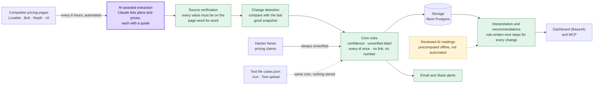
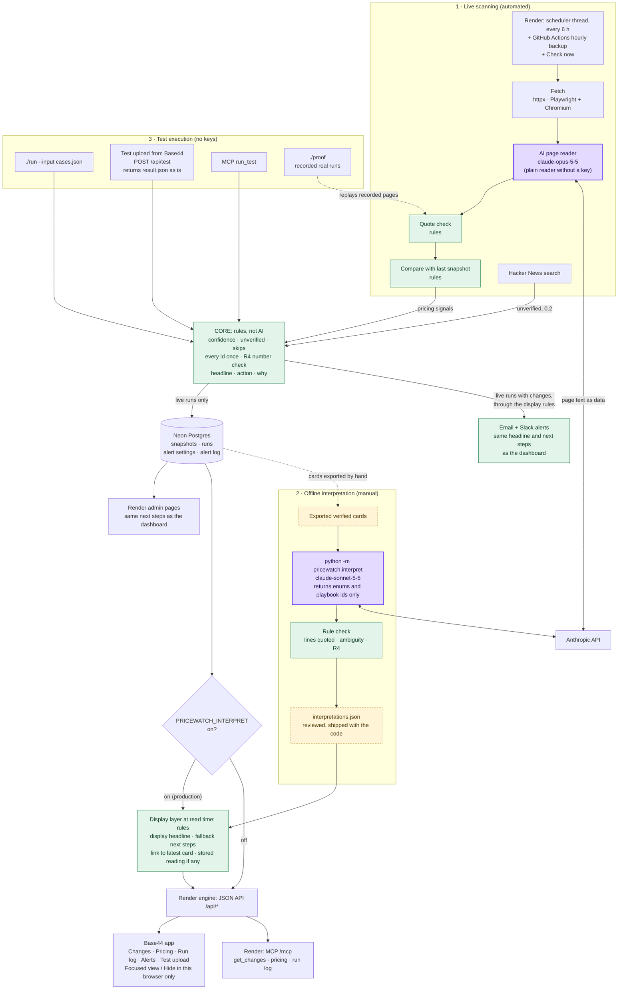

# Architecture

Status: **the authoritative technical description, as built**, checked against the code and production on 3 November 2026 (D44). The first version was approved by Guy on 25 October (D13); `DECISIONS.md` records every change since, and this document no longer keeps the original proposal's wording where the build moved away from it. The section "What changed since the original submission" lists those moves.

`docs/spec.md` is what we're building and why. This document is how.

## One idea holds it together

The brief requires the live app and the test interface to share the same logic, with only the source of signals different. So the system is split into **sources** that produce signals and **one core** that turns signals into Maya's items:

```
LIVE:  pricing pages ─▶ fetch ─▶ read plans (AI, quote-checked) ─▶ compare with last snapshot ─┐
       Hacker News ─▶ pricing claims (always unverified) ─────────────────────────────────────┤
                                                                                              ├─▶ CORE ─▶ result (items, skipped, run)
TEST:  cases.json ─▶ ./run, Test upload or MCP run_test ──────────────────────────────────────┘
```

- **Core** (`src/pricewatch/core/`, shared, rules only): accounts for every input id exactly once; normalises timestamps; skips launches, ads and unknown types with a reason; sets confidence and the unverified label from the `source` field; writes the headline, `action`, `steps` and `why` from templates; attaches `sources`; checks that every figure in the text is in a source (R4); redacts credential-like input values.
- **Live source** (`live.py`, `sources/`): fetches, reads, compares and stores, then hands the differences to the core as `pricing` signals in the same shape as a test file's signals.
- **Test source** (`sources/file.py`, `web.run_upload`, `web.mcp_run_test`): reads a `cases.json`.

Everything after the core that only changes **how a live card is presented** (the interpretation layer below) sits outside the core, behind a flag, and never reaches the test contract.

## The three paths

| Path | Starts from | Runs | Writes | AI calls |
| --- | --- | --- | --- | --- |
| **1. Live scanning** | The scheduler on Render every 6 hours, Check now, the GitHub backup, or `./run --live` | fetch → read → compare → core → store → alerts | A snapshot and a run document in Neon; one alert-log row per run with changes | The page reader (Claude, per page view), when a key is set |
| **2. Offline interpretation** | A person running `python -m pricewatch.interpret` on exported cards | Claude reads each eligible verified card and returns enums and ids; rules check them | `src/pricewatch/interpretations.json`, reviewed and committed by hand | Yes, but never in production: the file ships with the code |
| **3. Test execution** | `./run --input`, Test upload (`POST /api/test`, `POST /test`) or MCP `run_test` | The core only | Nothing, unless the uploader ticks a TEST alert (one alert-log row) | None |

The display layer that serves the dashboard is a fourth, read-time step: `GET /api/changes` (and MCP `get_changes`) runs `interpret.annotate` over the stored cards on every request, with `PRICEWATCH_INTERPRET=on`. It's deterministic code. It reads the replay file from path 2 but never calls a model.

## Diagrams

The same two diagrams as the README.

**A. Product architecture.** Purple: AI on every live run. Green: rules. Dashed yellow: AI run offline by hand.



**B. Detailed technical architecture.** Live scanning, offline interpretation and test execution, and where they meet. There is no live AI interpretation: the only model call in production is the page reader.



## Component inventory

What each part is and how it runs today. "Production" means the Render service and the published Base44 app on 3 November, checked through the MCP connector and the Base44 app's source.

| Component | Code | Kind | Runs in production |
| --- | --- | --- | --- |
| Scheduled scanning every 6 hours | `web._schedule`, `web.run_if_due`; `.github/workflows/schedule.yml` as hourly backup | Deterministic | **Fully automated.** A thread in the app checks every 5 minutes and starts a run once the last is 6 hours old. The run log shows runs about every 6 hours, mostly `schedule`, some `backup schedule` |
| Fetching | `sources/fetch.py` | Deterministic | Automated. httpx for Replit and v0; headless Chromium (Playwright) for Lovable and Bolt, both billing views |
| Pricing-page extraction | `sources/ai_extract.py` (`claude-opus-5-5`, low effort); `sources/extract.py` as plain fallback | **AI during live runs** | Automated. About $0.21–0.24 a run. Without a key or when the call fails, the plain reader runs |
| Source verification (quote check) | `extract.unquoted`, `extract.checked_table` (used by `ai_extract.read_page`) | Deterministic | Automated. Every value the AI returns must be on the page word for word, or it's dropped; table rows must be consecutive page lines |
| Confidence and unverified label | `core/trust.py` | Deterministic | Automated. From the `source` field only (0.9 / 0.6 / 0.4 / 0.2) |
| Change detection and snapshots | `sources/compare.py`, `store.py` | Deterministic | Automated. Each page view is compared with its last good reading by the same reader; failed pages are never compared |
| Hacker News rumors | `sources/rumors.py` | Deterministic | Automated, on live runs only. Always unverified, 0.2 |
| Core rules and rule-written text | `core/engine.py`, `core/text.py` | Deterministic | Automated, shared by every path |
| Storage | `store.py` | Deterministic | Neon Postgres (`DATABASE_URL`); SQLite locally and in tests |
| Enhanced interpretation | `interpret.py` (`interpret`, `check`) | **AI offline only** | Not automated. Run by hand on 3 Nov over 8 eligible cards; output reviewed and shipped as `interpretations.json` |
| Precomputed interpretations | `src/pricewatch/interpretations.json`, `interpret.load` | Data file | Deployed with the app. Matched to cards by card id, so a new card never picks up an old reading |
| Feature flag | `PRICEWATCH_INTERPRET` (`interpret.enabled`) | Config | **On** in production (set in Render's dashboard, not in `render.yaml`). Off, every endpoint is byte for byte as before (tested) |
| Display headlines, next steps, links to the latest card | `interpret.display_headline`, `display_steps`, `latest_of` | Deterministic, at read time | Automated: every new card gets them on its first request. These are the "fallback recommendations" for cards the replay doesn't cover |
| Test upload | `web.run_upload`, `web.test_rows`; Base44 `TestUpload.jsx` | Deterministic | Live. Core only; no interpretation layer |
| CLI | `./run`, `cli.py` | Deterministic | Standard library only, no keys |
| `./proof` | `proof.py` | Deterministic | CI and any fresh clone. Not part of the live service |
| Alerts (email, Slack) | `notify.py`, `web.alert` | Deterministic | Automated after each live run that finds changes, when the channels are configured. Since D45, the same headline and next steps as the Changes tab (`interpret.next_steps`), with quote and link |
| MCP server | `mcp_server.py`, `/mcp` | Deterministic server; the AI is the client | Live, read-only. `get_changes` returns the same annotated items as `/api/changes` |
| Render admin pages | `web.py` HTML routes | Deterministic | Live, as an admin fallback. Same headlines and next steps as the dashboard (D45) |
| Base44 front end | `frontend/` (snapshot of the Base44 app) | Frontend only | Published at brightloop-competitors-price-pulse.base44.app; calls the Render JSON API |
| Focused view / Hide | `frontend/src/lib/hidden.js` | **Frontend only** | Live. localStorage in one browser; never reaches the API, MCP, scans, alerts or counters |

## Where AI is used, and where it isn't

**AI reads; rules decide (D38).** AI is used in exactly three places, and only one of them runs on its own in production.

| Job | How | When | Guardrail |
| --- | --- | --- | --- |
| Reading plans and prices from a pricing page | **AI** (`ai_extract.py`) | Every live run | Every value must be in a quote found word for word on the page; anything else is dropped. Page text is sent as data. Plain reader fallback |
| Interpreting a verified change in plan contents (D40) | **AI** (`interpret.py`) | **Offline only**, by hand, then reviewed | Returns enums, playbook ids and copied page lines; writes no text. Rules accept or reject each reading and choose the text. Shipped as a file |
| Answering questions about the data (D37) | **AI**: the user's own MCP client | When someone asks | Read-only tools; server instructions say to quote and link any number. Not enforceable once the client writes its own prose |
| Whether a change happened | Rule (`compare.py`) | Every run | No AI |
| Confidence, unverified label, skips, id accounting | Rule (`core/`) | Every path | Never reads the signal's text |
| Headline, `action`, `why` stored on the card | Rule, one template per kind of change (D26) | Every path | Every figure must be in the sources (R4) |
| Display headline and next steps for new cards (D42, D43) | Rule, over the page lines the check compared | Every `/api/changes` request | Every figure must be in the sources; never says "removed feature", "price change" or "discontinued" from a missing line |
| Status (Needs investigation, Change confirmed…) | Rule, over a checked interpretation | Only on cards with an interpretation | No interpretation, no status |

**Without a key** (a fresh clone, CI): the plain reader replaces the AI reader, `./run --input` and `./proof` never needed one, and the interpretation layer only reads its shipped file.

**Source verification vs. business interpretation.** "Source verified" means the quote is on the competitor's own pricing page. It says nothing about what the change means. A card can be source verified and still "Needs investigation", and the card says both, separately.

## Confidence rule

| Where the claim came from | Confidence | Label |
| --- | --- | --- |
| The competitor's own pricing page | 0.9 | — |
| The competitor's own site, another page | 0.6 | — |
| News or other third party | 0.4 | unverified |
| Sponsored post, ad, Reddit, Hacker News, anonymous, no source | 0.2 | unverified |

## Recommendations: which text a card shows

A live card can carry three layers of "what to do". Only the first is part of the contract.

1. **The core's `action`, `steps` and `why`** (stored with the card, and in `result.json`). Written by rule from the kind of change. For plan-contents changes it says "anything we publish that quotes what X's plan includes is now out of date: read the change above and update it", which is broad. The test contract and alerts use this layer.
2. **`display_steps`** (dashboard and MCP, flag on, cards without an interpretation). Written by rule from what the page itself changed: a removed plan description, a removed line, several changed lines, an added line, a removed price mark, a price moved to or from a plan line. They ask Maya to check before anyone acts. This is the safe fallback every new change gets.
3. **`interpretation`** (dashboard and MCP, flag on, the 8 replayed cards). The checked AI reading with its status, open question, observation across checks and rule-chosen actions.

The Base44 card picks the interpretation's actions, else `display_steps`, else the core's `steps`. Since D45 the run log, alerts and admin pages make the same choice through one helper, `interpret.next_steps` (with `shown_headline` for the headline); Test upload and `result.json` keep the core's text. A card without an interpretation never shows a status, question or impact, so it's never presented as analysed.

## Live data and test inputs: shared core, different presentation

The test contract (`./run`, Test upload, MCP `run_test`) returns **exactly the core's result**, with the flag on or off. `tests/test_test_contract.py` checks that the three doors give the same `result.json` for every case file. The dashboard's display layer isn't applied to test files on purpose:

- It needs live cards: its rules parse the quote the comparison writes ("Pro plan now shows … and no longer shows …") and the kind of change set by the comparison. A hand-written test signal has neither, so most test cards would get nothing from it.
- Interpretations are matched by live card id; a test file has none.
- The brief's contract is what reviewers check. Changing its output to match a presentation layer would put the assignment's acceptance criteria at risk for no gain.

So Test upload shows the core's rule-written text, and the page now says so (D44).

## Stack

| Part | Choice | Why |
| --- | --- | --- |
| Language | **Python 3.12** | Fetching, parsing and tests; `./run` and `./proof` need only the standard library |
| Engine and API | **FastAPI** on **Render** (Docker, Playwright image, Starter plan, always on, D22) | Public URL, deploys from GitHub, Chromium for Lovable and Bolt |
| Marketer front end | **Base44** app (React + Vite), source mirrored in `frontend/` (D32, D39) | Reverses D13's original "not Base44": marketers shouldn't use the admin pages |
| Admin front end | Server-rendered HTML in `web.py` | Fallback if Base44 is down |
| Fetching | `httpx` for Replit and v0; **Playwright** for Lovable and Bolt (D14, D23) | JavaScript-built plans and billing toggles |
| AI | Anthropic API: `claude-opus-5-5` for page reading; `claude-sonnet-5-5` for the offline interpretation | |
| Storage | **Postgres** on Neon in production; **SQLite** locally, in CI and the proof | Snapshots, runs, alert settings and alert log survive restarts |
| Schedule | In-app thread every 6 hours (D21 update); GitHub Actions hourly as backup (`unless_ran_within_hours=5.5`) | GitHub dropped most scheduled triggers on the first night (3 of 13 fired) |
| Alerts | Gmail SMTP or Resend; Slack bot (D34–D36) | Maya works in other tools |
| MCP | Streamable HTTP, stateless, standard library (`mcp_server.py`, D37) | Any assistant can query the data |
| Tests and CI | **pytest** + GitHub Actions on every push: tests, `./run` on the sample, a keyless live run from saved pages, `./proof` | |

## Commands

| Command | What it does | Keys |
| --- | --- | --- |
| `./run --input cases.json --output result.json` | The brief's test interface | None |
| `./proof` | Replays the brief's sample and the recorded real runs, checks the rules, exits 1 on any failure | None |
| `./run --live --output result.json` | One live run, as the schedule does | Anthropic key for the AI reader; Playwright |
| `./run --live --pages fixtures/pages/2026-10-26 --no-ai --db /tmp/x.db --output r.json` | A live run from saved pages | None |
| `./record` | Records one real run into `fixtures/recorded/` | Anthropic key |
| `python -m pricewatch.interpret --input cards.json --output interpretations.json` | The offline interpretation | Anthropic key |
| `python -m pricewatch.reprocess <started_at> [--apply]` | Rebuilds one logged run's cards with the current comparison rules | Database |

## Repository layout

```
src/pricewatch/
  core/              signals → items: accounting, trust, timestamps, text, R4 check, redaction
  sources/           fetch, extract (plain reader), ai_extract (AI reader), compare, rumors, file
  live.py            one live run: collect, compare, core, store
  store.py           snapshots, runs, alert settings and log (Postgres or SQLite)
  web.py             FastAPI: JSON API, admin pages, Test upload, Check now, scheduler, MCP endpoint
  mcp_server.py      MCP protocol (JSON-RPC over HTTP)
  notify.py          email and Slack alerts
  interpret.py       offline interpretation + read-time display layer
  interpretations.json   the reviewed replay
  proof.py, record.py, reprocess.py, cli.py
frontend/            the Base44 app's source (snapshot, D39)
fixtures/            the brief's sample, saved pages, recorded real runs, interpretation inputs
tests/               pytest, plus tests/cases/ (case files with expected results)
```

## What changed since the original submission (29 October)

On 29 October the submitted system was: the shared core, the AI reader with quote checks, comparison and snapshots on Neon, the 6-hour schedule, Hacker News rumors, the Base44 app (Changes, Current pricing, Run log, Alerts, Test upload, Check now), email and Slack alerts, MCP, and `./proof`. Everything since is listed in `DECISIONS.md`:

| When | What | Kind |
| --- | --- | --- |
| 30 Oct – 2 Nov (PRs #40–#44) | Bolt's billing toggle read reliably on Render; Lovable's "Platform fee" no longer flagged as a price change when the reader files it differently | Reliability fixes to live fetching and comparison |
| 3 Nov (PRs #45, D40) | Offline AI interpretation of verified plan-contents changes, behind `PRICEWATCH_INTERPRET` | New layer, offline |
| 3 Nov (PR #46, D41) | One card component with statuses set by rule | Frontend + display rules |
| 3 Nov (PR #47, D42) | Display headlines from the page lines, links from older cards to the latest one | Display rules |
| 3 Nov (PR #48, D43) | Rule-written next steps for every new card, simpler counters, Focused view / Hide | Display rules + frontend |
| 3 Nov (this audit, D44) | Test upload rows fixed for numeric and empty ids; Test upload cards explained; docs made authoritative | Fixes and docs |

None of them changed the core, the test contract, the confidence rules, the quote check or the alerts.

## Known limitations

1. **Enhanced interpretation isn't automatic.** Only the 8 cards in the replay have one. New changes get the deterministic display steps. The next step is below.
2. **The stored `action` is still the core's broader text.** Every screen and alert shows the dashboard's next steps (D45), but `result.json`, the raw `action`/`steps` fields and MCP clients that read them still say "now out of date" for plan-contents changes.
3. **`./proof` replays recorded runs from 25–26 October, which had no changes.** Real changes since then are covered by unit tests on their stored cards (`fixtures/interpret/`), not by a recorded replay.
4. **Test upload has no size limit** (MCP's `run_test` caps at 1 MB). A 5,000-signal file answers in under a second.
5. **The `frontend/` snapshot isn't built or deployed from this repo.** Base44 builds and publishes it; changes here must be copied into Base44 and published.
6. **Anyone with the link can change live alert settings** (D34) and press Check now (rate-limited, D29).
7. **Bolt's page** failed on some runs on 1–2 November (toggle timeouts) before PR #44; failed pages are reported and never compared.

## Next engineering step: automatic interpretation without weakening verification

The pieces exist; what's missing is running them on new cards and storing the result:

1. After a live run saves its cards, call `interpret.interpret` on the run's eligible cards (verified, own pricing page, plan contents, limits, plans added or removed). Cap the calls per run and the cost per day.
2. Store each record (model, prompt version, answer, interpretation or fallback reason) in a new `interpretations` table keyed by card id, never in the run document. The card stays as the core wrote it.
3. `interpret.load` reads the table as well as the file. Everything else stays: `check` still accepts or rejects each reading, playbook text is still chosen by code, R4 still applies, and a failure still leaves the card with its display steps.
4. Keep it behind a second flag, run it in shadow mode for a week (store but don't show), and review the readings against Maya's feedback before showing them.
